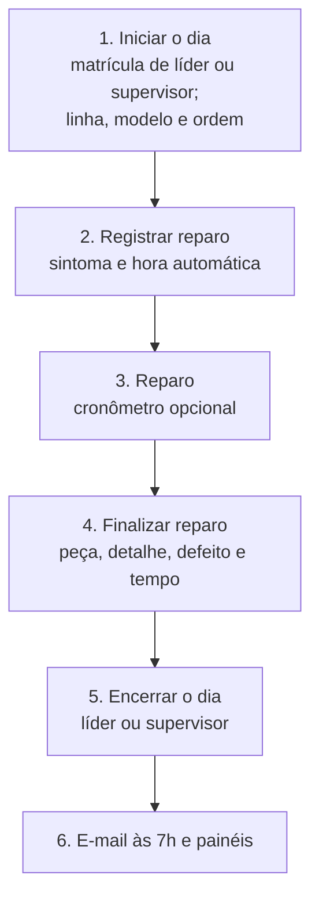
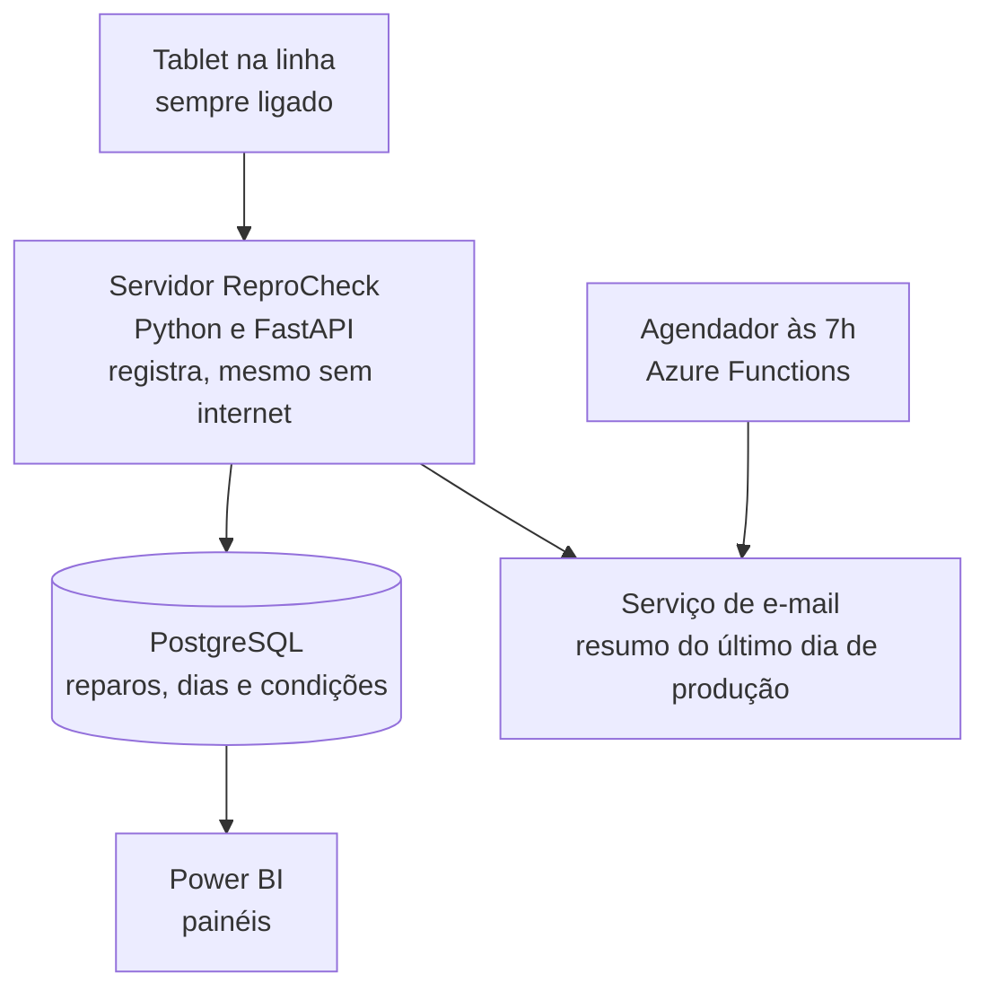

# ReproCheck

Registro, acompanhamento e análise de reparos (reprocessos) na linha de montagem de fábricas de manufatura: poucos passos para o operador e um resumo pronto toda manhã para quem decide.

**Projeto acadêmico de Engenharia de Software**

**Protótipo online:** https://reprocheck-cp7ipawu.manus.space/

---

## Sobre o Projeto

### Em uma frase

O ReproCheck mostra, toda manhã, quantas máquinas voltaram para reparo em cada linha de montagem, por quê (sintoma, peça e defeito) e quanto tempo o reparo levou, porque o operador registra cada caso em poucos passos, na hora em que acontece, em um tablet que fica ligado na linha.

### O que é

O ReproCheck é um sistema para registrar, acompanhar e analisar reprocessos em fábricas de manufatura com linhas de montagem. Um reprocesso acontece quando uma máquina apresenta um problema (por exemplo, "não ligou") e precisa voltar para reparo. Cada um custa tempo, material e capacidade da linha, e é isso que o sistema torna visível. O cenário usado neste projeto é uma fábrica com 12 linhas de montagem.

### O problema

Quando o registro de reprocessos é feito em papel ou em planilha, no fim do turno, aparecem sempre os mesmos problemas:

- o dado chega tarde, e o supervisor só descobre o que aconteceu dias depois;
- cada pessoa dá um nome diferente ao mesmo problema, e a análise vira adivinhação;
- ninguém sabe se uma linha sem registro teve um dia perfeito ou se simplesmente ninguém anotou nada;
- quando o reparo termina em outro dia, os números do dia do problema ficam errados e a causa se perde;
- não fica registrado se o problema veio de um equipamento ruim ou de um operador em treinamento, e sem isso não dá para saber se o remédio é manutenção ou capacitação;
- sistemas que exigem login a cada uso gastam tempo demais da linha, e o operador acaba não registrando.

### Para quem é e para quem não é

- **É para:** fábricas de manufatura, com linhas de montagem que fazem as mesmas máquinas ao longo dos dias e supervisores que precisam acompanhar várias linhas.
- **Não é:** um sistema de gestão da produção (planejamento, estoque, compras). A ordem de produção entra só como informação de contexto, para saber em qual ordem cada reparo aconteceu.

---

## Como funciona

1. **Iniciar o dia.** De manhã, o líder, o supervisor ou alguém de cargo superior liga o tablet, toca em "Iniciar o dia" e digita a matrícula. O sistema só abre se a matrícula for de um desses cargos. Em seguida, escolhe a linha de montagem, o modelo da máquina e a ordem de produção. Esses dados valem para o dia inteiro, e o operador não precisa escolher de novo.
2. **Registrar reparo.** O tablet (o totem) fica ligado na linha. Quando uma máquina apresenta um problema, o operador toca em "Registrar reparo" e escolhe o sintoma (por exemplo, "não ligou"). A hora é marcada sozinha. Um pop-up pede o código do operador para confirmar.
3. **Reparar.** O operador conserta a máquina. Se quiser, usa o cronômetro integrado (opcional) para medir o tempo.
4. **Finalizar reparo.** Ele informa a peça reparada (parafuso), o detalhe (parafuso do módulo), o defeito (parafuso do módulo roçado) e o tempo do reparo em segundos. Pode concluir na hora ou deixar o reparo pendente e finalizar depois, em "Reparos pendentes". Mais uma vez, um pop-up com o código confirma.
5. **Encerrar o dia.** O líder, o supervisor ou alguém de cargo superior encerra o dia, pelo "Acesso de liderança". Se ninguém encerrar, o sistema fecha sozinho de madrugada.
6. **Resumo às 7h e painéis.** Todo dia útil, os supervisores recebem por e-mail o resumo das linhas, referente ao último dia de produção. Gestores acompanham tendências e horários críticos em painéis no Power BI.

**Por que o código só aparece no final?** O totem fica ligado o dia inteiro e ninguém faz login para registrar. A identificação vem do código digitado em um pop-up que aparece só no fim de cada ação (registrar ou finalizar um reparo), porque pedir login a cada uso gastaria tempo demais da linha.

**Em paralelo: condições da linha.** No "Acesso de liderança", em "Condições da linha", o líder ou o supervisor registra se há operador em treinamento ou equipamento com defeito. O sistema liga essa informação aos reparos sozinho, sem pedir nada a mais ao operador. O operador também pode avisar de um equipamento com defeito pelo botão simples "Sinalizar equipamento".

---

## Um dia com o ReproCheck

**Sexta, de manhã.** A líder Ana liga o tablet da linha 2, toca em "Iniciar o dia" e digita a matrícula. O sistema confere que é de uma líder e abre. Ela escolhe a linha 2, o Modelo A e a ordem de produção do dia. Depois, no "Acesso de liderança", abre "Condições da linha" e marca que a parafusadeira 2 está desregulada e que o operador Davi está em treinamento.

**14h20.** Uma máquina chega ao fim da linha e não liga. O operador Carlos toca em "Registrar reparo" e escolhe o sintoma "Não ligou". A hora é marcada sozinha. Um pop-up pede o código dele, e Carlos confirma.

Carlos abre a máquina e liga o cronômetro. O problema era um parafuso do módulo roçado. Ele troca o parafuso, para o cronômetro (372 segundos) e conclui o reparo, escolhendo a peça "parafuso", o detalhe "parafuso do módulo" e o defeito "parafuso do módulo roçado". Outro pop-up pede o código. O sistema liga sozinho esse reparo à condição "parafusadeira 2 desregulada", que estava ativa naquele horário.

**Fim do turno.** Ana vai ao "Acesso de liderança" e toca em "Encerrar o dia". O sistema mostra o que ficou em aberto e avisa que a linha 5 não teve o dia iniciado, e por isso ela aparecerá como "sem coleta".

**Segunda, 7h.** Os supervisores recebem o resumo de sexta, já separando "zero reprocessos" de "sem coleta".

---

## Quem usa

| Perfil | O que faz no sistema |
|---|---|
| Operador | Registra e finaliza reparos no totem, confirmando com o código dele, e pode sinalizar equipamento com defeito |
| Líder | Inicia o dia (com a matrícula), registra as condições da linha, finaliza reparos e encerra o dia, pelo "Acesso de liderança" |
| Supervisor | Pode iniciar e encerrar o dia, recebe o e-mail das 7h e acompanha suas linhas |
| Gestor ou analista (cargo superior) | Também pode iniciar o dia e usa os painéis para achar causas e tendências |
| Administrador | Cuida dos cadastros (pessoas, modelos, ordens, equipamentos, catálogo de defeitos) e dos destinatários do e-mail |

---

## Diferenciais

- **Poucos passos:** registrar o reparo, escolher o sintoma e confirmar, pensado para operador de luva em ambiente barulhento.
- **Sem login no totem:** o código do operador só é pedido em um pop-up, no fim de cada ação.
- **Contexto do dia definido uma vez:** linha, modelo da máquina e ordem de produção são escolhidos no início do dia.
- **Reparo descrito em três níveis:** peça, detalhe e defeito, o que padroniza os nomes e facilita a análise.
- **Cronômetro opcional** para medir o tempo do reparo em segundos.
- **A data de origem manda:** o reprocesso sempre pertence ao dia em que o problema foi identificado, mesmo que o reparo termine depois (veja a seção de regras).
- **"Zero reprocessos" e "sem coleta" são coisas diferentes,** e o sistema separa as duas sozinho: dia iniciado e nenhum reparo é "zero"; dia nunca iniciado é "sem coleta".
- **Condições da linha:** operador em treinamento e equipamento com defeito ficam registrados e ligados aos reparos, para separar o que pede manutenção do que pede treinamento.
- **Configurável por fábrica e por setor industrial** (ciclo 3).

---

## Como saberemos se funciona

| Pergunta | Indicador |
|---|---|
| O supervisor fica sabendo a tempo? | O dado chega, no máximo, no e-mail das 7h do próximo dia de produção |
| O operador usa? | Parcela dos problemas registrados no totem (e não no papel) e reparos registrados em até 3 passos |
| O dado é confiável? | Parcela dos reparos com sintoma, peça e defeito padronizados e dias encerrados com conferência (e não "não conferido") |
| O dado explica as causas? | Parcela dos reprocessos com condição da linha registrada ou com defeito identificado |
| O e-mail chega? | E-mails entregues às 7h em todos os dias úteis |

---

## Replicação entre fábricas

O ReproCheck foi pensado para ser instalado em várias fábricas de manufatura, inclusive de setores diferentes (alimentos, automotivo, eletrônicos e outros). O que muda de uma fábrica para outra é configuração, não código:

- cadastro das linhas, dos modelos de máquina e dos equipamentos;
- catálogo de sintomas e de peças, detalhes e defeitos do setor;
- cargos e matrículas, destinatários do e-mail e horário do envio;
- recurso instalado: um tablet por linha.

O que não muda são as regras: data de origem, início e encerramento do dia e a separação entre "zero" e "sem coleta". Vários clientes podem usar o mesmo sistema com os dados totalmente separados (modo multiempresa, ciclo 3).

---

## Glossário

| Termo | Significado |
|---|---|
| Reprocesso | Máquina que apresentou problema e voltou para reparo |
| Linha de montagem | Sequência de postos de trabalho em que a máquina é montada |
| Modelo da máquina | Tipo de máquina que a linha está montando no dia |
| Ordem de produção | Documento que define o que a linha deve produzir; aqui, usada como contexto do dia |
| Sintoma | O que o operador percebe, por exemplo "não ligou" |
| Peça, detalhe e defeito | Os três níveis que descrevem o reparo: a peça (parafuso), o detalhe (parafuso do módulo) e o defeito (parafuso do módulo roçado) |
| Matrícula | Número que identifica cada funcionário e seu cargo |
| Código do operador | Número que o operador digita no pop-up para confirmar uma ação (pode ser a própria matrícula) |
| Totem | Tablet fixo na linha, sempre ligado, onde os operadores registram os reparos |
| Acesso de liderança | Área do tablet reservada a líder, supervisor e cargo superior, com "Condições da linha" e "Encerrar o dia" |
| Data de origem | Dia e hora em que o problema foi identificado e registrado |
| Fechamento do dia | Momento em que o líder, o supervisor ou um cargo superior confere o dia e trava os registros (botão "Encerrar o dia") |
| Condição da linha | Situação registrada que pode influenciar os problemas, como operador em treinamento ou equipamento com defeito |

---

## Regras Principais: Reprocessos e Fechamento do Dia

Esta seção registra o entendimento do negócio que orienta o sistema.

### Conceitos

- **Data de origem:** dia e hora em que o reparo foi registrado no totem. A hora é marcada automaticamente no toque, mesmo que o dado só chegue ao servidor depois, por falta de Wi-Fi.
- **Data de conclusão:** dia e hora em que o reparo é finalizado.
- **Tempo de reparo:** tempo de trabalho no reparo, em segundos, medido pelo cronômetro ou digitado (opcional).
- **Tempo em aberto:** tempo entre o registro e a finalização do reparo. É diferente do tempo de reparo.
- **Status do reprocesso:** Em aberto ou Finalizado. O reprocesso nasce **Em aberto**, quando o operador registra o reparo, e passa a **Finalizado** quando o reparo é finalizado.

### Regra 1: o dia de origem manda

Um reprocesso registrado no dia 5 e finalizado no dia 6 aparece no dia 5. O reparo ajuda a explicar aquele dia. Na gestão da qualidade, as causas de um problema costumam ser agrupadas em seis categorias (diagrama de causa e efeito de Kaoru Ishikawa): mão de obra (quem operava), máquina, material (de que lote veio o componente), método, medição e meio ambiente (por exemplo, um dia de chuva e umidade alta). Todas dependem das condições do dia em que o problema nasceu, não do dia em que foi consertado. Se o reprocesso fosse contado no dia 6, o dia 5 pareceria melhor do que foi, o dia 6 pareceria pior, e a causa ficaria ligada ao dia errado.

Por isso cada reprocesso guarda duas datas, e os relatórios usam sempre a data de origem. Ao finalizar, o operador registra a peça, o detalhe e o defeito, e os relatórios cruzam isso com as condições da linha.

### Regra 2: início e encerramento do dia

**Iniciar o dia**

- **Quem pode:** líder, supervisor ou cargo superior. O sistema consulta o cargo da matrícula digitada e só abre se for um desses.
- **O que se escolhe:** linha de montagem, modelo da máquina e ordem de produção. Valem para o dia, e todo reparo registrado fica ligado a eles.
- **Se o modelo ou a ordem mudar no meio do dia:** o líder ou o supervisor entra no "Acesso de liderança" (com a matrícula), a área do tablet reservada a quem lidera, e troca o modelo ou a ordem ali. Os reparos já registrados continuam ligados ao modelo e à ordem em que nasceram. (Essa troca ainda não existe no protótipo; faz parte da versão completa.)
- **Operadores:** não fazem login. O código deles é pedido só no pop-up de confirmação, no fim de cada ação.

**Encerrar o dia**

- **Quem pode:** líder, supervisor ou cargo superior, pelo "Acesso de liderança", digitando a matrícula. O sistema registra quem encerrou e quando.
- **Checklist antes de encerrar:**
  - reparos ainda em aberto são listados (não impedem o encerramento);
  - linhas cujo dia nunca foi iniciado aparecem como "sem coleta", e o líder pode informar o motivo (por exemplo, linha parada);
  - linhas com dia iniciado e nenhum reparo contam como "zero reprocessos", sem precisar de pergunta.
- **O que o encerramento trava:** os registros daquele dia. Os reparos em aberto continuam ligados ao dia de origem.
- **Fechamento automático de segurança:** se ninguém encerrar, o sistema fecha de madrugada e marca o dia como "não conferido".
- **O que ainda pode mudar depois de encerrado:**
  - finalizar um reparo em aberto: é o fluxo normal. O dia de origem é atualizado e o sistema registra quem finalizou (pelo código) e quando;
  - corrigir um dado já registrado: só com justificativa, e fica na auditoria.
- **Reparo parado há muito tempo:** um reparo em aberto além de um limite configurável aparece destacado nos painéis e no e-mail.
- **Registro feito offline:** se o tablet registrou antes do encerramento mas só sincronizou depois, o reprocesso entra no dia correto e aparece marcado como "chegou após o fechamento", sem apagar nada.

**Exemplo: um reprocesso que atravessa o fim de semana**

| Quando | O que acontece | Como o sistema trata |
|---|---|---|
| Sexta, 23/10, 16h | Operador registra um reparo na linha 1 (sintoma: não ligou) | Data de origem = 23/10. Status: em aberto |
| Sexta, fim do dia | Líder encerra o dia | Dia encerrado. O reparo segue em aberto, ligado a 23/10 |
| Segunda, 26/10, 7h | E-mail do último dia de produção (sexta) | Mostra "1 em aberto" na linha 1 |
| Segunda, 26/10, 9h | Operador finaliza o reparo (peça, detalhe, defeito e tempo) | Status: finalizado. Os painéis de 23/10 são atualizados |
| Terça, 27/10, 7h | E-mail do último dia de produção (segunda) | Seção "Finalizados de dias anteriores": 1 reprocesso, origem 23/10 |

### Regra 3: o "último dia de produção"

O e-mail das 7h não resume simplesmente "ontem". Ele resume o último dia de produção, que é o último dia em que algum dia foi iniciado no tablet:

- segunda envia o resumo de sexta, porque sábado e domingo não tiveram produção;
- se terça for feriado e ninguém iniciar o dia, quarta envia o de segunda;
- sábado, domingo e feriados sem produção não geram e-mail.

### Regra 4: o e-mail das 7h

**Assunto:** Resumo de reparos: sexta, 23/10 (dados fictícios)

| Linha | Reprocessos | Em aberto | Tempo de reparo |
|---|---|---|---|
| 1 | 6 | 1 | 1h40 |
| 2 | 3 | 0 | 45 min |
| 3 | sem coleta | n/d | n/d |
| 4 | 0 | 0 | 0 |
| ... | ... | ... | ... |
| **Total** | **41** | **2** | **9h20** |

A coluna "Reprocessos" conta todos os reparos registrados no dia; "Em aberto" é parte desse total.

Linha 3: o dia não foi iniciado. Linha 4: o dia foi iniciado e não houve reparo. O e-mail separa as duas situações, para o supervisor não achar que a linha 3 foi perfeita.

O tempo de reparo soma só os reparos finalizados que têm tempo informado (o cronômetro é opcional), e é atualizado nos painéis quando um reparo em aberto é finalizado. Cada e-mail enviado é guardado exatamente como foi enviado, enquanto os painéis sempre mostram o dado atualizado.

Extras opcionais: seta de tendência em relação ao dia anterior, destaque da linha com mais reprocessos, peça e defeito mais frequentes do dia e quantos reprocessos tiveram condição da linha registrada.

### Regra 5: condições da linha (treinamento e equipamento com defeito)

Alguns problemas não vêm de falha do processo, e sim de uma condição conhecida: um operador ainda em treinamento ou um equipamento com defeito, como uma furadeira ou uma parafusadeira desregulada. Para não pedir nada a mais ao operador durante o reparo, essas condições são registradas uma vez, em "Condições da linha" (dentro do "Acesso de liderança"), pelo líder ou pelo supervisor, e o sistema as liga sozinho aos reparos. O operador só tem um botão simples para avisar de equipamento com defeito:

- **Operador em treinamento:** o líder marca o operador e o período de treinamento. Os reparos confirmados com o código dele ficam com a marca "em treinamento".
- **Equipamento com defeito:** o líder informa qual equipamento e desde quando, ou o operador toca em "Sinalizar equipamento", escolhe o equipamento na lista e confirma com o código (a hora é automática). O líder confirma depois. Enquanto durar, os reparos da linha ficam com a marca "equipamento sinalizado".

Cada condição tem início e fim, como a data de origem do reprocesso: o que vale é a situação no momento em que o problema nasceu.

**Para que serve:** separar o que pede manutenção (equipamento), o que pede treinamento (pessoas) e o que ainda não tem explicação. A marca é um indício, não uma prova. A marcação de treinamento serve para planejar capacitação, e não para avaliar pessoas: nos relatórios ela aparece como condição, sem nome.

---

## Tecnologias, Ferramentas e Infraestrutura

### Arquitetura

O mesmo tablet atende operadores, líder e supervisor. O que cada pessoa pode fazer depende da matrícula ou do código digitado.

### Tecnologias escolhidas

| Camada | Escolha | Por quê | Alternativa considerada |
|---|---|---|---|
| Servidor (back-end) | Python + FastAPI (conjunto de ferramentas prontas para criar a interface de programação, que permite aos sistemas conversarem) | Rápido, simples, ótimo para tratar dados e gera documentação automática | Django: mais completo, porém mais pesado para o que precisamos |
| Banco de dados | PostgreSQL | Relacional: garante integridade (todo reparo ligado a uma linha, a um modelo, a uma ordem e a um dia), aguenta consultas de análise e guarda datas com fuso horário | MongoDB: flexível, mas aqui as relações e as regras de integridade são o centro do sistema |
| Telas (frontend) | Aplicativo web progressivo em React (site instalável que funciona como aplicativo e guarda dados offline) | Um único código atende o tablet da linha e continua funcionando sem Wi-Fi, inclusive o cronômetro | Aplicativo nativo Android: acesso melhor ao aparelho, porém mais caro de manter |
| Análise | Power BI + pandas (biblioteca Python de dados) | Painéis para gestores e limpeza de dados | Metabase: gratuito, mas menos usado onde já se usa o ecossistema Microsoft |
| E-mail e agendamento | SendGrid + Azure Functions (agendador) | Envio confiável às 7h, com reenvio em caso de falha e proteção contra e-mail duplicado | Rotina agendada dentro do próprio servidor: mais simples, mas some se o servidor reiniciar |
| Nuvem | Microsoft Azure | Integra com Power BI e com o login corporativo | Amazon Web Services: mais variedade, sem a integração direta |
| Contêineres | Docker | Empacota o sistema com tudo que precisa, igual em qualquer máquina (e facilita instalar em outra fábrica) | Instalar direto na máquina: cada ambiente fica diferente |
| Automação | GitHub Actions (integração e entrega contínuas: testes e publicação automáticos a cada alteração) | Evita publicar código quebrado | Jenkins: exige servidor próprio |
| Testes | pytest | Testa as regras mais delicadas (lista abaixo) | unittest: mais trabalhoso de escrever |

**Regras que os testes automáticos precisam cobrir:**

- "Iniciar o dia" só abre para matrícula de líder, supervisor ou cargo superior;
- o pop-up só grava o reparo com código de operador válido, e código inexistente não grava nada;
- reparo finalizado sem tempo informado (cronômetro opcional) é aceito;
- último dia de produção calculado a partir dos dias iniciados, com feriado no meio da semana;
- reprocesso em aberto atravessando um ou mais dias e voltando para o dia de origem ao ser finalizado;
- registro feito offline e sincronizado depois do encerramento;
- e-mail enviado uma única vez, mesmo após falha e reenvio;
- condição da linha com início e fim ligada apenas aos reparos do período certo.

### Modelo de dados (principais tabelas)

| Tabela | Para que serve | Campos principais |
|---|---|---|
| pessoas | Cadastro de quem usa o sistema | matrícula, nome, cargo (operador, líder, supervisor ou superior), código do operador, ativa |
| linhas | Cadastro das linhas de montagem (12 no cenário do projeto) | número, nome, ativa |
| modelos_maquina | Modelos de máquina produzidos | nome, ativo |
| ordens_producao | Ordens de produção | número, modelo, ativa |
| inicios_dia | Início do dia em cada linha | linha, data, modelo, ordem, quem iniciou (matrícula e cargo), quando |
| equipamentos | Equipamentos de cada linha | nome (ex.: parafusadeira 2), linha, ativo |
| sintomas | Lista padronizada de sintomas | nome (ex.: não ligou) |
| catalogo_reparos | Catálogo em três níveis | peça, detalhe, defeito, ativo |
| reprocessos | Cada reparo registrado | linha, modelo, ordem, sintoma, peça, detalhe, defeito, operador (código), data de origem, data de conclusão, tempo de reparo em segundos (opcional), condições ativas (ligadas automaticamente), status (em aberto ou finalizado) |
| condicoes_linha | Condições que podem influenciar os problemas | linha, tipo (operador em treinamento, equipamento com defeito, outra), operador ou equipamento, início, fim, quem registrou (líder, supervisor ou operador que sinalizou), confirmada pelo líder (sim ou não), observação |
| fechamentos | Situação de cada dia | data, status (aberto, encerrado, fechado automático não conferido), quem encerrou (matrícula e cargo), quando, motivos de "sem coleta", observações do dia (ex.: chuva) |
| destinatarios | Supervisores que recebem o e-mail | nome, e-mail, linhas, ativo |
| historico_envios | Cada e-mail enviado | dia de referência, destinatário, situação, tentativas, cópia do conteúdo enviado |
| auditoria | Correções feitas depois do encerramento | quem, quando, o que mudou, justificativa |

### Infraestrutura física (por linha)

- Tablet Android industrial em suporte (totem), sempre ligado.
- Wi-Fi na linha; o tablet funciona offline e sincroniza depois, preservando o horário de cada registro.

### Segurança e privacidade

- **Sem login no totem, com identificação no fim da ação:** o código do operador é pedido em um pop-up ao registrar ou finalizar um reparo. É uma troca consciente de segurança forte por velocidade, e a rastreabilidade vem do registro de quem confirmou e quando.
- **Cargos e matrícula:** só líder, supervisor ou cargo superior iniciam e encerram o dia.
- Dia encerrado trava os dados registrados; correção só com justificativa e registro de auditoria.
- Lei Geral de Proteção de Dados: nome e matrícula com acesso restrito.
- A marcação de operador em treinamento aparece nos relatórios como condição, sem nome.
- Conexão segura (criptografada), backup diário e senhas fora do código.

### Ferramentas de projeto

Protótipo clicável em HTML (telas, feito com apoio de uma ferramenta de inteligência artificial), Mermaid (diagramas) e GitHub Projects (quadro Kanban).

---

## Metodologias

### Escolha: modelo em Espiral

Um modelo de processo é a receita de como a equipe constrói o software: entender o problema, projetar, programar, testar e entregar. Os modelos se diferenciam por duas perguntas: quando o usuário vê o sistema? e quando os riscos são tratados?

### Por que não Cascata?

No modelo em Cascata, as fases (requisitos, projeto, código, testes, entrega) acontecem uma única vez, em sequência, cada uma terminando antes da próxima começar. É como construir um prédio: depois que a laje está pronta, mudar a escada de lugar custa muito. A lógica por trás é que, segundo estudos de Barry Boehm (*Software Engineering Economics*, 1981), o custo de corrigir um erro cresce quanto mais tarde ele é descoberto, e o Cascata empurra a descoberta para o fim, quando o usuário finalmente vê o sistema. (O artigo de Winston Royce, de 1970, ao qual o desenho é atribuído, já alertava que seguir esse fluxo sem voltar atrás era arriscado.)

O Cascata funciona bem quando os requisitos são estáveis, a tecnologia é conhecida e o risco é baixo. Neste projeto, não é o caso:

- **Incerteza de adoção:** só testando para saber se o operador, de luva, registra um reparo em poucos passos, e se o pop-up de código ajuda ou atrapalha.
- **Ambiente e equipamento:** barulho, poeira e Wi-Fi instável só aparecem em teste real, e equipamento não se refaz como código.
- **Risco técnico:** o e-mail diário e os painéis dependem de dados reais, que só existirão depois que o sistema estiver em uso.
- **Requisitos que surgem na conversa:** a regra da data de origem, o pop-up de confirmação no lugar do login e a área de condições da linha só apareceram ao discutir a rotina real da fábrica. Num Cascata, seriam descobertos com o sistema pronto e em uso.
- **Erro tardio é caro:** descobrir na entrega que o totem não serve obriga a refazer software e equipamento.

Aproveitamos do Cascata a ideia de fases ordenadas e documentadas, mas dentro de cada volta da Espiral.

### Por que Espiral?

O modelo em Espiral (Barry Boehm, 1986) trata o projeto como uma sequência de voltas. Cada volta repete 4 etapas:

1. Definir os objetivos da volta.
2. Analisar os riscos e fazer um protótipo (versão barata e rápida, feita só para testar uma dúvida).
3. Desenvolver e testar.
4. Avaliar com os usuários e planejar a próxima volta.

O diferencial é a análise de riscos explícita: os maiores perigos do projeto são tratados primeiro, antes de se gastar mais. É como lançar um tênis novo: antes de fabricar milhares de pares, faz-se um par, atletas testam e só então se ajusta e se produz.

### Ciclos do projeto

| Ciclo | Entrega | Risco principal | Como reduzir | Critério para encerrar a volta |
|---|---|---|---|---|
| 1. Registro | Tablet na linha com iniciar o dia (matrícula), registrar e finalizar reparo, pop-up de código, cronômetro opcional, reparos pendentes, histórico, condições da linha e encerrar o dia. O protótipo cobre este ciclo | Operador não adotar | Protótipo clicável em HTML e teste com operadores | Operador registra um reparo em até 3 passos, de luva, no teste real |
| 2. Resumo e análise | Servidor e banco de dados reais, e-mail às 7h com o último dia de produção e painéis no Power BI | Reprocesso que atravessa dias, falha no e-mail, feriados e marcação de treinamento ser vista como punição | Regra da data de origem validada com líderes, reenvio automático do e-mail e relatórios de treinamento sem nome | Dia encerrado sem perder reparos em aberto, e e-mail correto em dias úteis, feriado e fim de semana |
| 3. Expansão | Configuração por setor industrial (alimentos, automotivo, eletrônicos, plásticos) e modo multiempresa (vários clientes com dados separados) | Cada setor tem problemas e rotinas próprios | Começar com um setor extra: alimentos, que acrescenta lote e validade | Segundo setor configurado sem alterar o código |

### Limites da Espiral e como lidamos com eles

A Espiral exige boa análise de riscos, pesa mais na gestão e pode não ter fim claro se ninguém definir quando parar. Por isso, cada ciclo acima tem um critério para encerrar a volta. Também não usamos um método ágil sozinho, como o Scrum, porque ele não tem uma etapa própria de análise de riscos, e aqui o risco é o ponto central.

### Práticas ágeis dentro dos ciclos

Quadro **Kanban** (A fazer, Em andamento, Em revisão, Feito) no GitHub Projects, para acompanhar as tarefas de cada ciclo.

---

## Projeto de Interface

O tablet da linha foi pensado para ser **o mais simples possível**: botões grandes, poucos elementos por tela e nenhum login. O menu inicial tem só três opções: **Iniciar o dia**, **Consultar histórico** e **Reparos pendentes**. Cada tela tem **um botão principal grande** e, no máximo, dois botões pequenos, e cada passo aparece sozinho (uma lista por vez). As opções do líder (Condições da linha e Encerrar o dia) ficam em um botão pequeno, "Acesso de liderança", que pede a matrícula.

As telas 1 a 9 (tablet da linha) têm um **protótipo clicável em HTML**, feito com apoio de uma ferramenta de inteligência artificial (Manus) a partir de um rascunho das telas.

- **Online:** https://reprocheck-cp7ipawu.manus.space/
- **Arquivo:** `index.html`, que vai junto com este documento. Para abrir, basta dar dois cliques nele.

O protótipo cobre **somente o tablet da linha**. O e-mail das 7h, os painéis no Power BI e os cadastros do administrador estão descritos neste documento (ciclos 2 e 3), mas **não estão no protótipo**. Os dados do protótipo são fictícios e ficam só na página: ao recarregar, voltam ao começo.

**Como testar (2 minutos):**

1. Toque em "Iniciar o dia", digite a matrícula `2001` (líder) e confirme com OK.
2. Escolha linha, modelo e ordem e toque em "Começar".
3. Toque em "Registrar reparo", escolha um sintoma e digite o código `1001` (operador) no pop-up.
4. Toque em "Concluir reparo", escolha peça, detalhe e defeito, toque em "Finalizar" e digite `1001` de novo.
5. Volte ao menu e veja o reparo em "Consultar histórico" e os que estão em "Reparos pendentes".
6. Em "Acesso de liderança" (matrícula `2001`) ficam "Condições da linha" e "Encerrar o dia".

**Catálogo grande:** no protótipo, as listas mostram todos os itens de exemplo. Como o catálogo real de sintomas e defeitos é grande, o sistema final terá, em cada passo, os itens mais usados, uma busca e o botão "ver todos", sempre uma lista por vez.

### Telas do sistema

| # | Tela | Quem usa | O que faz |
|---|---|---|---|
| 1 | Menu inicial | Todos | Três botões grandes: Iniciar o dia, Consultar histórico e Reparos pendentes, e um botão pequeno "Acesso de liderança" |
| 2 | Iniciar o dia | Líder, supervisor ou superior | Pede a matrícula (só abre para esses cargos) e escolhe linha de montagem, modelo da máquina e ordem de produção |
| 3 | Registro de reprocesso | Operador | Botão "Registrar reparo", escolha do sintoma (ex.: não ligou) e hora automática; o reparo pode ser concluído na hora ("Concluir reparo") ou ficar em aberto ("Manter pendente"). Há também um botão pequeno "Sinalizar equipamento" |
| 4 | Finalizar reparo | Operador | Escolha de peça, detalhe e defeito, tempo em segundos e cronômetro opcional |
| 5 | Pop-up de confirmação | Operador | Pede o código do operador só no fim da ação (registrar ou finalizar) |
| 6 | Reparos pendentes | Operador e líder | Lista os reparos em aberto, com o botão "Finalizar" |
| 7 | Consultar histórico | Todos | Reparos já registrados, do mais recente ao mais antigo |
| 8 | Condições da linha | Líder ou supervisor | Marca operador em treinamento ou equipamento com defeito e confirma os equipamentos sinalizados pelos operadores |
| 9 | Encerrar o dia | Líder, supervisor ou superior | Mostra o resumo do dia e encerra o dia |
| 10 | Cadastros do administrador | Administrador | Cadastro de pessoas e cargos, modelos, ordens, equipamentos, catálogo de defeitos e destinatários do e-mail |
| 11 | Histórico de envios | Administrador e supervisor | Mostra cada e-mail, sua situação e permite reenvio |
| 12 | Painéis no Power BI | Gestor | Tendências, horários críticos, comparação entre linhas e reprocessos por condição |
